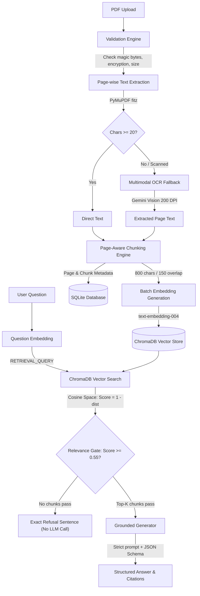

# DocuMind Architecture & Technical Design

## 1. System Overview

**DocuMind** is an academic document assistant designed for university students and researchers. It enables users to upload academic PDFs (research papers, textbook chapters, lecture notes), ask grounded questions, receive factual answers with page-level citations, and generate structured summaries and paper overviews.

DocuMind uses a **fixed, deterministic Retrieval-Augmented Generation (RAG) pipeline**. It is intentionally not an autonomous agent system — it does not perform multi-step autonomous planning, arbitrary tool execution, or cross-session state mutation.

---

## 2. RAG Pipeline Architecture



---

## 3. Core Subsystems

### 3.1 Document Ingestion & Validation
- **Validation**:
  - Verifies file existence and non-zero size.
  - Verifies PDF magic header bytes (`%PDF-`).
  - Opens document using PyMuPDF and verifies that it is not password-protected (`is_encrypted == False`) and contains at least one page.
  - Rejects oversized files exceeding `MAX_FILE_SIZE_MB` (default 20 MB).
- **Collision Prevention**:
  - Each uploaded PDF is stored with a unique 12-character hexadecimal document ID prefix: `{document_id}_{sanitized_filename}`. Two uploads with the identical original filename never overwrite each other.

### 3.2 Page Extraction & OCR Fallback
- **Text Extraction**: Uses PyMuPDF page-by-page extraction (`page.get_text("text")`).
- **OCR Fallback**: If a page contains fewer than `OCR_MIN_CHARS` (default 20 characters), it is rendered as a 200 DPI PNG image and transcribed using Gemini's multimodal vision input.
- **OCR Error Handling**: Failed OCR operations record a safe warning in metadata and set extracted text to `""`. **Error placeholders like `[OCR failed]` are strictly excluded from the vector index.**
- **OCR Tracking**: OCR usage is tracked explicitly per page and aggregated into the document's persistent metadata (`used_ocr: bool`).

### 3.3 Page-Aware Chunking Engine
- Chunks text using natural boundaries: paragraphs (`\n\n`) first, then sentences.
- Parameters: `CHUNK_SIZE = 800` characters, `CHUNK_OVERLAP = 150` characters.
- Each chunk preserves exact source attribution: `chunk_id`, `document_id`, `start_page`, `end_page`, and `page_number`.
- Empty or failed pages are cleanly bypassed without polluting the index.

### 3.4 Persistent Vector Storage & Distance Semantics
- **ChromaDB**: Persisted locally in `VECTOR_DB_DIR` (e.g. `./data/chroma`).
- **Cosine Space Metric**:
  - Collections are explicitly initialized with `metadata={"hnsw:space": "cosine"}`.
  - In ChromaDB with cosine space, distance is cosine distance:
    $$\text{distance} = 1 - \cos(\theta)$$
  - Cosine similarity is computed as:
    $$\text{similarity} = 1 - \text{distance}$$
  - Variables in the codebase are strictly separated into `distance` and `score` / `similarity`.

### 3.5 SQLite Persistence Engine
- Replaces in-memory registries with SQLite via SQLAlchemy.
- Backed by table `documents`:
  - `document_id`: Primary Key (12-char hex).
  - `filename`: Sanitized original filename.
  - `storage_path`: Safe file location on disk.
  - `status`: Lifecycle status (`processing`, `ready`, `failed`).
  - `current_stage`: Stage progression (`validating`, `extracting`, `ocr`, `chunking`, `embedding`, `indexing`, `ready`, `failed`).
  - `progress_percent`: Numerical progress (0 to 100).
  - `num_pages`, `num_chunks`, `used_ocr`, `warnings_json`, `error_message`, `full_text`.
- Metadata survives backend restarts; persisted Chroma vectors remain immediately queryable.

### 3.6 Grounded Question-Answering & Retrieval Gate
- **Retrieval Gate**:
  - The user's question is embedded with task type `RETRIEVAL_QUERY`.
  - Top-K chunks are retrieved from the document's collection.
  - Chunks with similarity score $< \text{SIMILARITY\_THRESHOLD}$ (0.55) are filtered out.
  - **If zero chunks pass the threshold, the backend immediately returns the exact refusal sentence without calling the LLM generator.**
- **Exact Refusal Sentence**:
  `"The answer could not be found in the uploaded document."`
- **Structured Output**:
  - Generator is invoked with low temperature (0.2) and constrained by Pydantic JSON schema:
    ```json
    {
      "answerable": true,
      "answer": "Factual answer supported by context.",
      "cited_chunk_ids": ["chunk_0001"]
    }
    ```
  - Citations are validated: chunk IDs not present in the retrieved context are filtered out.
- **Grounding Level**:
  - `strongly_supported`: High confidence ($\ge 0.70$) with verified chunk citations.
  - `partially_supported`: Score between threshold and 0.70.
  - `insufficient_evidence`: Gate refused or generator found insufficient evidence.

### 3.7 Hierarchical Summarization & Paper Analysis
- **Hierarchical Summarizer**:
  - Large documents are split into manageable blocks ($\le 4000$ characters).
  - Map phase generates intermediate grounded summaries per block.
  - Reduce phase synthesizes intermediate summaries into `short_summary` and `detailed_summary`.
  - Avoids context window saturation or single oversized API calls.
- **Structured Paper Analysis**:
  - Extracts title, authors, abstract, keywords, methodology, dataset, results, limitations, future work, and references into typed Pydantic models.

---

## 4. Security & Engineering Constraints

1. **Secret Protection**: `GEMINI_API_KEY` is loaded exclusively from environment variables or `backend/.env`. The key is never logged, never returned in health checks or error payloads, and never committed to version control.
2. **Untrusted Document Text**: Document contents are treated as untrusted data. Embedded prompt injection attempts (e.g. "Ignore previous instructions") cannot override system prompts.
3. **Rate Limiting**: Sliding-window rate limiter protects expensive endpoints (`upload`, `query`, `summarize`, `analysis`) against abusive traffic (default 30 requests/minute).
4. **Cascading Cleanup**: Deleting a document removes its SQLite record, its ChromaDB collection, and its stored PDF file on disk.
5. **No False Zero-Hallucination Claims**: RAG significantly mitigates hallucination risk, but cannot mathematically eliminate it. All user-facing APIs and documentation maintain honest grounding claims.
